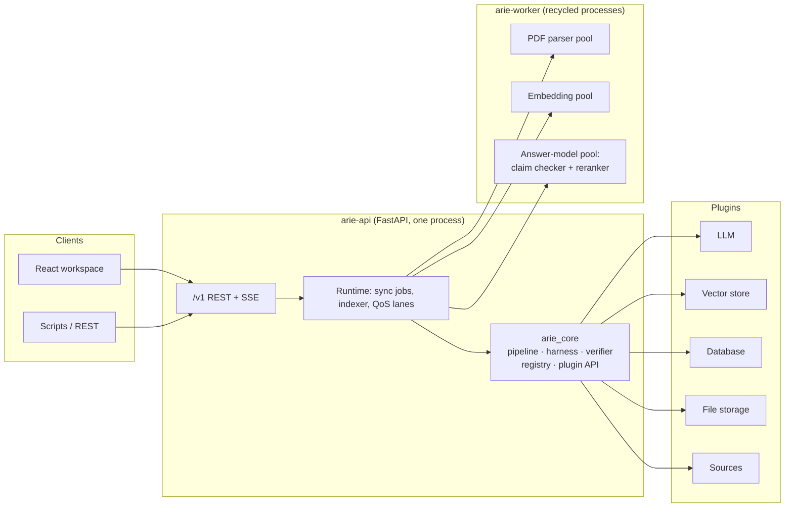
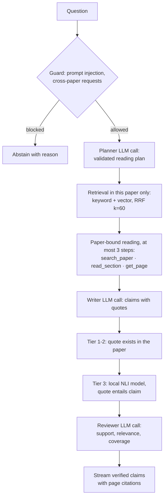

# ARIE — Agentic Research Intelligence Engine

ARIE is a local-first research assistant for academic papers. It syncs papers from
sources such as arXiv, extracts their text, and answers questions about one paper at a
time. Every statement in an answer carries an exact quote and page citation from that
paper, and is checked before you see it.

ARIE is built as a **microkernel**: a small core (about 5,000 lines, three
dependencies) holds the pipeline, safety checks and the question-answering loop.
Everything that talks to the outside world is a **plugin**: the LLM, embedder, vector
store, database, file store, PDF parser, paper sources and claim checker. You choose
plugins in `arie.yaml`, bring your own by dropping a class into `plugins/` or
installing a package, and fork the core without touching vendor code.

- [Features](#features)
- [Quick start](#quick-start)
- [Architecture](#architecture)
- [Plug and play: bring your own components](#plug-and-play-bring-your-own-components)
- [Configuration reference](#configuration-reference)
- [Memory and CPU](#memory-and-cpu)
- [Using the workspace](#using-the-workspace)
- [Development](#development)
- [License](#license)

## Features

- **Grounded answers.** An answer contains only claims backed by a quote that exists in
  the paper. Quotes are matched exactly (Tier 1), then after Unicode and ligature
  normalization (Tier 2), and a local natural-language-inference model checks that each
  quote actually supports its claim (Tier 3). If no claim survives, ARIE abstains or
  shows exact source excerpts and says why.
- **One paper at a time.** Questions are answered from the selected paper only.
  Retrieval tools never receive a paper ID from the model, and every result row is
  filtered by paper again, so text from another paper cannot leak in.
- **Bounded cost.** Each question is capped at 3 tool calls, 12,000 input tokens, 700
  output tokens and 25 seconds, enforced in code.
- **Automated ingestion.** Syncs arXiv and Google DeepMind papers by month, year or
  range, resumes interrupted runs, and imports a single paper from its arXiv link.
  Downloads are size-limited, host-restricted and validated as PDFs before saving.
- **Hybrid search.** Keyword ranking (term overlap with section-aware routing, in the
  core) and vector search are fused with reciprocal rank fusion inside the selected
  paper. Without an embedder, keyword search still works.
- **Swappable everything.** Change the LLM provider, embedder, vector store, database,
  parser or sources in `arie.yaml` or in **Settings**, without code changes.
- **Workspace UI.** A React workspace with a paper library, live sync activity, chat
  with page citations, and the original PDF beside the extracted text.

## Quick start

### Docker

Requires Docker Engine with Compose v2. Give Docker at least 3 GB of memory.

```sh
cp .env.example .env          # add the keys you use (see below)
docker compose up --build -d
```

Open <http://localhost:8080>. The API listens on <http://127.0.0.1:8000>.

With the shipped `arie.yaml`, chat uses DeepSeek (`DEEPSEEK_API_KEY`) and embeddings use
Gemini (`GEMINI_API_KEY`). Without an LLM key, chat shows labelled source excerpts.
Without the embedding key, search is keyword-only and **Storage & health** shows the
vector index as degraded.

```sh
docker compose ps                 # health of both services
docker compose logs -f api        # API and extraction logs
docker compose restart api        # reload .env after changing keys
docker compose down               # stop; library data is kept
docker compose down -v            # stop and delete papers, database and settings
```

The `api` service runs FastAPI and its worker processes. The `web` service is the built
React app on nginx, which proxies `/v1` and `/mcp` to the API. The `arie-data` volume
holds the database, PDFs, model caches and the active `arie.yaml`. The first start
copies the repository's `arie.yaml` into the volume; settings saved in the UI update that
copy. To replace it with your edited file:

```sh
docker compose cp arie.yaml api:/app/data/arie.yaml
docker compose restart api
```

For live reload while editing code:

```sh
docker compose -f docker-compose.yml -f docker-compose.dev.yml up --build
```

Python changes restart the API, `prompts/` edits apply to the next question, and
`web/src` changes hot-reload. Dependency changes (`uv.lock`, `web/package-lock.json`)
need `--build`.

### Local

Requires Python 3.14+, [uv](https://docs.astral.sh/uv/) and Node.js.

```sh
uv sync
uv run uvicorn arie_api.routes:app --host 127.0.0.1 --port 8000 --loop uvloop
```

In a second terminal:

```sh
cd web && npm install && npm run dev
```

The first start downloads the claim-checker model (about 280 MB) into the Hugging Face
cache (`HF_HOME`, by default `~/.cache/huggingface`). Until it is ready, chat answers
with exact source excerpts.

## Architecture



### Packages

| Path | Role |
| --- | --- |
| `core/arie_core/plugin_api/` | The plugin contract: the `@plugin` decorator, one `Protocol` per slot, `ScrapedPaperInput`. This is the only module plugins may import. |
| `core/arie_core/contracts/` | Frozen `msgspec` data types passed between core and plugins (`VectorRow`, `Hit`, `LLMRequest`, `Evidence`, ...). |
| `core/arie_core/registry/` | Discovers plugins, validates `arie.yaml`, builds plugin instances, circuit breakers. |
| `core/arie_core/pipeline/` | Ingestion state machine, PDF gatekeeper, section-aware chunker. |
| `core/arie_core/harness/` | Question answering: guard, planner, paper-bound reading, reranking, writer, verifier, reviewer. |
| `core/arie_core/budget/`, `sched/` | Token and tool budgets, QoS lanes, per-host rate limits. |
| `api/arie_api/` | FastAPI app: REST and server-sent events, answer models, per-paper evaluation. `runtime/` holds the runtime in layers: `base` (config, plugins, pools), `library`, `vectors`, `sync` (sync and import jobs), `chat`. |
| `worker/arie_worker/` | Supervised, recycled worker processes for CPU-heavy work. |
| `plugins/` | Bundled plugins, one package per folder. |
| `sdk/` | The `arie` CLI for scaffolding and testing plugins. |
| `prompts/` | Versioned prompts: `qa.v1.yaml` (planner, writer, reviewer) and `eval.v1.yaml` (evaluation questions). |
| `contract_tests/` | Slot contract tests run against every discovered plugin. |
| `web/` | React 19 workspace. |
| `docs/adr/` | Architecture decision records. |
| `docs/SPEC.md` | System specification: how each part works today, step by step, with time budgets, failure reasons and known gaps. |

The core imports no vendor SDK and no plugin. `make check` enforces this with
`import-linter`, so a fork can replace any plugin without editing the core.

### Ingestion pipeline

Each paper moves through a resumable state machine:

```
DISCOVERED → GATED → DOWNLOADING → PARSED → INDEXED
```

1. **Discover.** A source plugin returns paper metadata for a date window, one page at
   a time. Every record is validated as a `ScrapedPaperInput` (unknown fields rejected,
   `..` or `\` in IDs rejected).
2. **Gate.** Category and keyword filters decide relevance without an LLM.
3. **Download.** The PDF is streamed in 64 KB chunks from the source's declared hosts
   only (redirects to other hosts are refused). It is aborted above 25 MB or if the
   first 1024 bytes lack `%PDF-`, and saved atomically (`.pdf.part`, then rename).
4. **Parse.** The parser plugin extracts text, tables and pages in a worker process.
5. **Index.** Each section is split into paragraph chunks of at most 2,200 characters
   (tables and equations stay whole, and a "Table N" caption stays with its table),
   with exact source offsets, and saved with keyword search. The paper is now
   chat-ready.
6. **Embed** (background). The indexer embeds chunks in the embedding worker and writes
   them to the vector store. It backfills old papers and re-embeds the library when the
   embedder model changes.

A failed paper is recorded with its reason and never blocks the rest of a sync.

### How a question is answered



- The reading steps run in code, not as model tool calls. The paper ID is bound before
  any step runs, so the model cannot ask for another paper, and every row a step returns
  is filtered by paper again.
- Tables are quoted as text. A table longer than 650 bytes offers its caption, header
  and first rows (up to 1,200 bytes) as one quote; contents listings are never
  evidence. Figures and charts are not read: only their caption text is searchable.
- Vector search gets at most 6 seconds and always leaves 10 seconds for writing and
  review. If it fails, retrieval falls back to keyword search.
- If the LLM, the claim checker or credentials fail, the answer is a set of labelled
  exact source excerpts with the reason. Generated text from earlier turns is never
  reused as evidence.
- Prompts live in `prompts/qa.v1.yaml`; new questions load the current file.

### Process model

`arie-api` is one asyncio process. CPU-heavy work runs in separate worker processes,
never in API threads:

| Pool | Runs | Limits |
| --- | --- | --- |
| PDF | parser plugin | 60 s per paper, 1.5 GB memory, recycled after 20 papers (configurable for the parser) |
| Embedding | embedder plugin | defaults above; lower CPU priority |
| Answer models | entailment and reranker plugins, in one shared process | defaults above; normal priority so answers stay fast |

A worker that exceeds a limit is killed and replaced; only that task fails. PDF and
embedding workers run at lower CPU priority (`nice 10`), and the PDF pool never starts
more processes than there are CPUs ([ADR 0006](docs/adr/0006-background-cpu-priority.md)).

Inside the API, a sync job runs one at a time and processes one paper at a time. Up to
two single-paper imports run beside it, and evaluations run one at a time. Chat is not
queued behind any of these: it has priority only through the workers' CPU priority. arXiv
requests are spaced 3 seconds apart.

The claim checker and reranker share one worker that runs one call at a time. A call that
passes its caller's budget keeps running, so the loaded models stay in memory, and the
next call waits behind it. Each step's time budget and fallback is listed in
[`docs/SPEC.md`](docs/SPEC.md#81-pipeline-and-time-budget).

### Design invariants

These rules hold for every change, including plugins:

1. **Paper isolation.** Q&A tools never expose `paper_id` to the model; it is bound in
   code and every vector, SQL or MCP row is filtered by it.
2. **No unverified claims.** Every claim cites a quote that passes the verifier, or the
   answer abstains.
3. **Bounded execution.** 3 tool calls, 12,000 input tokens, 700 output tokens and 25
   seconds per question.
4. **Clean ingestion.** Source output is validated, network access is limited to
   declared hosts, PDFs are size- and type-checked, and writes are atomic.
5. **No vendor code in the core.** The core imports no SDK or plugin; plugins import only
   `arie_core.plugin_api` and `arie_core.contracts`, never each other.

Decisions behind them are in [`docs/adr/`](docs/adr/README.md).

## Plug and play: bring your own components

### Slots

A **slot** is a role in the system; a **plugin** fills a slot. These slots are wired
into the runtime:

| Slot | You implement | Bundled plugins | Select with |
| --- | --- | --- | --- |
| `llm` | `complete(ctx, request)`, `stream(ctx, request)` | `deepseek`, `openai`, `gemini`, `openai-compatible` | `plugins.llm.use` |
| `embedder` | `embed(ctx, texts) -> list[list[float]]` | `fastembed` (local), `openai`, `gemini` | `plugins.embedder.use` |
| `vector_store` | `upsert`, `search`, `delete`, `stats` | `exact` (SQLite file) | `plugins.vector_store.use` |
| `database` | `execute(ctx, sql, params)`, `fetch(ctx, sql, params)` | `sqlite`, `mcp-sql` | `plugins.database.use` |
| `file_storage` | `read(ctx, path)`, `write(ctx, path, content)` | `local` | `plugins.file_storage.use` |
| `parser` | `parse(ctx, file_path) -> ParsedDoc` | `pymupdf4llm`, `docling` (OCR) | `plugins.parser.use` |
| `source` | `fetch_page(ctx, since, until, cursor, limit)`, `allowed_hosts` | `arxiv`, `deepmind` | `plugins.sources` (a list) |
| `entailment` | `score(ctx, pairs) -> list[float]` | `nli-onnx` | `plugins.entailment.use` |
| `reranker` | `score(ctx, query, passages) -> list[float]` | `onnx-cross-encoder` | `plugins.reranker.use` |

The exact signatures and contracts are the `Protocol` classes in
[`core/arie_core/plugin_api/__init__.py`](core/arie_core/plugin_api/__init__.py).
`openreview` is an example source that implements only `discover()`, so it cannot be
used for sync until it gains `fetch_page()`.

### How plugins are found

At startup the registry looks in two places:

1. **Folders under `plugins/`.** Every `.py` file in a plugin folder is imported, and
   any class decorated with `@plugin(slot=..., name=...)` is registered. Each folder
   needs a `pyproject.toml`, because `plugins/*` are uv workspace members.
2. **Installed packages** that declare an `arie.plugins` entry point. This is how you
   ship a plugin from its own repository:

   ```toml
   [project.entry-points."arie.plugins"]
   chroma = "arie_vector_chroma.plugin"
   ```

A plugin that fails to import is skipped and logged with the reason; the rest of ARIE
still starts. `GET /v1/plugins` and **Settings** list what was found.

### Write a plugin in four steps

**1. Scaffold the package.**

```sh
uv run arie plugin new --slot vector_store --name memory
```

This creates `plugins/vector_store-memory/` with a `pyproject.toml` and a plugin class.
The generated class has a placeholder `run()` method; replace it with the methods of
your slot (except for `source`, which gets a matching template).

**2. Implement the slot.** A complete vector store that passes the slot contract tests:

```python
import math
from collections.abc import Mapping, Sequence

from arie_core.contracts import Hit, VectorRow, VectorStats
from arie_core.plugin_api import Ctx, plugin


@plugin(slot="vector_store", name="memory")
class MemoryVectorStore:
    """In-process cosine index; vectors are lost on restart."""

    def __init__(self, max_rows: int = 100_000) -> None:
        self.max_rows = max_rows
        self.rows: dict[str, VectorRow] = {}

    async def upsert(self, ctx: Ctx, rows: Sequence[VectorRow]) -> None:
        for row in rows:  # validate the whole batch first: no partial writes
            if not row.metadata.get("paper_id") or not row.metadata.get("model"):
                raise ValueError("every row needs paper_id and model metadata")
        self.rows.update({row.id: row for row in rows})

    async def search(
        self, ctx: Ctx, query: Sequence[float], k: int, *, filters: Mapping[str, str]
    ) -> list[Hit]:
        def cosine(a: Sequence[float], b: Sequence[float]) -> float:
            norm = math.sqrt(sum(x * x for x in a)) * math.sqrt(sum(y * y for y in b))
            return sum(x * y for x, y in zip(a, b)) / norm if norm else 0.0

        matches = [
            Hit(row.id, cosine(query, row.vector), dict(row.metadata))
            for row in self.rows.values()
            if all(row.metadata.get(key) == value for key, value in filters.items())
        ]
        return sorted(matches, key=lambda hit: hit.score, reverse=True)[:k]

    async def delete(self, ctx: Ctx, *, filters: Mapping[str, str]) -> None:
        self.rows = {
            key: row
            for key, row in self.rows.items()
            if not all(row.metadata.get(f) == v for f, v in filters.items())
        }

    async def stats(self, ctx: Ctx) -> VectorStats:
        return VectorStats(vectors=len(self.rows))
```

**3. Test it.** The contract suite runs every slot's tests against every discovered
plugin, so your plugin is tested as soon as it is found:

```sh
make test-contracts                       # all plugins
uv run arie plugin test vector_store-memory
```

Put your own plugin tests in `contract_tests/`, not under `plugins/`: every `.py` file
in a plugin folder is imported at startup.

**4. Select it** in `arie.yaml`. Keys other than `use` are passed to the constructor:

```yaml
plugins:
  vector_store: {use: memory, max_rows: 50000}
```

Restart the API. In Docker, run `uv lock` and rebuild the image after adding a plugin
package.

### Rules for plugin authors

- Import only `arie_core.plugin_api` and `arie_core.contracts` from ARIE. Never import
  another plugin.
- Take `ctx: Ctx` as the first argument of every call. It carries the deadline
  (`ctx.deadline`, a `time.monotonic()` value), a trace ID and the budget; respect the
  deadline.
- Any plugin that makes network requests declares `allowed_hosts` and must not follow
  redirects to other hosts.
- Keep heavy models out of the API process. Embedder, entailment, reranker and parser
  plugins run in worker processes; load models lazily on the first call.
- Let errors propagate. The core decides the fallback (keyword search, source excerpts
  or a failed paper) and shows the reason.
- A vector store or database must still return correct rows when the core filters by
  `paper_id`; the core filters again either way.

### Recipes

**A local or self-hosted LLM** (Ollama, vLLM, LM Studio or any OpenAI-compatible
server):

```yaml
llm_providers:
  openai-compatible: {model: llama3.1, api_key_env: LOCAL_LLM_KEY, base_url: http://localhost:11434/v1}
plugins:
  llm: {use: openai-compatible}
```

Set `LOCAL_LLM_KEY` in `.env` to any non-empty value if the server needs no key.

**An online or local embedder.** Online embedders free about 350 MB of memory and the
CPU used for indexing, but send paper text to the provider:

```yaml
plugins:
  embedder: {use: gemini}       # or openai, or fastembed (local), or auto
```

`auto` follows the LLM provider when it offers embeddings and its key is set, and
otherwise uses local FastEmbed. Changing the embedder re-embeds the library in the
background; until a paper is done, its search is keyword-only. Each embedder has a
calibrated similarity floor in `embedding_providers.<name>.min_score`.

**A database behind an MCP server.** `mcp-sql` sends SQL to a stateless MCP SQL server
over HTTP:

```yaml
plugins:
  database: {use: mcp-sql, server_url: http://127.0.0.1:9000/mcp, allowed_hosts: [127.0.0.1]}
```

**A new paper source.** Implement `fetch_page(ctx, since, until, cursor, limit)`
returning a `SourcePage` of `ScrapedPaperInput` records (`paper_id`, `title`, `source`,
`pdf_url`, and optional `abstract`, `authors`, `published_at`, `metadata`), declare
`allowed_hosts`, and call `await wait_for_source_host(ctx, host)` before each request
to respect rate limits. Add the name to `plugins.sources`.

**A different PDF parser.** Implement `parse(ctx, file_path) -> ParsedDoc`. Parser
workers may raise their own limits (see [Configuration reference](#configuration-reference)).

**A different claim checker.** Implement `score(ctx, pairs)` returning, for each
`(quote, claim)` pair, the probability that the quote entails the claim. Recalibrate
`plugins.entailment.min_score` for your model.

**A different reranker.** Implement `score(ctx, query, passages)` returning one
relevance score per passage, higher meaning more relevant. Scores are compared only
within one call, so any scale works.

**A new local model slot.** Local model plugins all run through one generic worker
pool (`arie_worker.models.ModelPool`), so a new slot needs no new pool class. Declare
its `Protocol` in `plugin_api`, add one `AnswerSlot` entry in
[`api/arie_api/models.py`](api/arie_api/models.py) (its warm-up call, status text and
fallback), and call its scores from the harness step that uses them. Configuration,
warm-up, retries, the shared worker and the health pane then come from that entry.

### Tools and MCP: current status

| Capability | Status |
| --- | --- |
| Custom Q&A tools | **Not pluggable yet.** The paper-bound reading steps are built into the harness. |
| Connect ARIE to an external MCP server as a tool | **Not available yet.** |
| Use an MCP server as the database | **Available** through `mcp-sql`. |
| Expose ARIE's paper tools over MCP (`POST /mcp/p/<handle>`) | **Preview.** The endpoint speaks MCP and verifies signed, paper-scoped handles (`ARIE_MCP_SECRET`), but it serves a built-in demo paper rather than your library, and no API route issues handles yet. |
| `reranker` slot | **Available.** `onnx-cross-encoder` (default) picks each answer's passages in `arie-worker` (ADR 0007). |

Pluggable tools are planned as a slot with two constraints from the design invariants:
a tool never receives `paper_id` from the model, and what it returns is context, not
evidence, unless it passes the verifier.

## Configuration reference

`arie.yaml` in the repository root (or the file named by `ARIE_CONFIG`):

| Section | Purpose |
| --- | --- |
| `plugins` | Which plugin fills each slot, plus constructor keys. |
| `llm_providers` | Default model, key variable, optional `base_url` and optional `context_tokens` (the context window explain mode plans for; defaults are 64,000 for DeepSeek and 128,000 for OpenAI and Gemini) per LLM plugin. |
| `embedding_providers` | Default model, similarity floor and key variable per embedder. |
| `explain` | `max_pack_share` (default 0.6): the whole paper goes in the prompt only if its estimated tokens are at most this share of the model's `context_tokens` ([ADR 0010](docs/adr/0010-explain-mode-paper-in-the-prompt.md)). Explain mode itself is not built yet. |
| `sync` | Default sync window and limits (see [Sync](#sync)). |
| `runtime_qos` | `utility_worker_processes` (PDF workers, capped to the CPUs), `slow_callback_threshold_ms` (event-loop lag warning) and `shared_model_worker` (default `true`: the claim checker and reranker share one process; `false` gives each its own). Older files may still carry `use_uvloop`, `user_initiated_override_concurrency`, `background_pdf_stream_concurrency` and `arxiv_rate_limit_delay_sec`; they are ignored and logged as deprecated. uvloop is chosen by the uvicorn `--loop` flag and arXiv spacing is fixed at 3 s. |

Keys for the local-model plugins:

| Key | Default | Effect |
| --- | --- | --- |
| `entailment.threads`, `embedder.threads` (`fastembed`) | 1 | CPU threads per model. Higher is faster per answer but uses more cores. |
| `entailment.min_score` | 0.5 | Claims scoring below this are dropped. |
| `entailment.max_length` | 512 | Tokens per quote and claim pair. |
| `reranker.threads` | 2 | CPU threads for the reranker; two keep 24 passages under its 3 s budget. |
| `reranker.max_length`, `reranker.batch_size` | 512, 8 | Tokens per passage, and passages scored per batch. |
| `entailment.memory_arena`, `reranker.memory_arena` | false | Keep ONNX Runtime's CPU memory arena. About 0.5 GB more memory for the answer worker, at the same measured speed. |

Worker limits for `plugins.parser` (every other `parser` key goes to the parser):

| Key | Default | Allowed | Effect |
| --- | --- | --- | --- |
| `timeout_sec` | 60 | up to 1800 | Kill the worker if one paper takes longer. |
| `max_rss_mb` | 1536 | 1536-8192 | Kill the worker above this memory. |
| `tasks_per_worker` | 20 | 1-20 | Replace the worker after this many papers. |

ARIE refuses to start if a value is out of range. The embedding and answer-model pools
always use the defaults.

`.env`:

| Key | Purpose |
| --- | --- |
| `DEEPSEEK_API_KEY`, `OPENAI_API_KEY`, `GEMINI_API_KEY` | Provider keys; set the ones you use. Keys stay on the server; the UI shows only whether each is set. |
| `ARIE_MCP_SECRET` | Signs MCP handles. Use a random value (`openssl rand -hex 32`) for shared deployments. |
| `ARIE_WEB_PORT`, `ARIE_API_PORT` | Docker host ports (default 8080 and 8000; the API binds to 127.0.0.1). |
| `ARIE_EXTRAS` | Docker image extras, such as `docling`. Rebuild after changing. |

## Memory and CPU

Measured on one machine; expect similar proportions elsewhere.

| Component | Memory | CPU |
| --- | --- | --- |
| Local embedder (`fastembed`, bge-small) | ~350 MB | short bursts while indexing; ~20 ms per question |
| Answer models: claim checker (`nli-onnx`) and reranker (`onnx-cross-encoder`), one shared worker | ~0.7 GB on Linux at the worst case per answer (12 claims, 24 long passages); ~1.2 GB with `memory_arena: true` | claim check ~0.2 s per claim on one thread; reranking up to 3 s on two threads |
| PDF worker (`pymupdf4llm`) | up to ~500 MB each | busy during sync, at lower priority |
| PDF worker (`docling`) | 1.4-1.5 GB peak per paper | 73-165 s per 15-page paper |

To make ARIE lighter:

- Use an online embedder (`embedder: {use: gemini}` or `openai`) to drop the local
  embedding model.
- Keep `threads: 1` on local models so one question uses about one core.
- Lower `runtime_qos.utility_worker_processes` to run fewer PDF workers at once.
- Keep `runtime_qos.shared_model_worker: true` (the default) and leave `memory_arena`
  off on the ONNX plugins ([ADR 0009](docs/adr/0009-one-model-pool-shared-answer-worker.md)).
- Set `reranker: {use: none}` to drop the reranker; answers then use keyword and
  vector order.
- Set `entailment: {use: none}` only on very small machines: claims then rest on quote
  matching and the LLM reviewer, without the Tier 3 check.

**Known issue on small machines.** The reranker's 3 s budget and the claim checker's
4 s budget were measured on an 8-core Mac. On a 2-vCPU Docker VM the worst cases
measured 9.7 s for reranking and 20.1 s for 12 long claim pairs
([ADR 0009](docs/adr/0009-one-model-pool-shared-answer-worker.md)). When the claim check
misses its budget, the answer falls back to exact source excerpts with
`fallback_reason: entailment_timeout` and the reviewer never runs. This timeout is not
logged, and **Storage & health** still shows the claim checker as healthy, because that
status reports only whether the model loaded. Check `fallback_reason` in the answer's
evaluation details or in an evaluation run. Steps to confirm the cause and fix options are
in [`docs/SPEC.md`](docs/SPEC.md#13-open-issue-evaluation-answers-fall-back-to-excerpts).

**Docling** adds layout analysis, table structure and OCR for scanned PDFs, at a much
higher cost:

```sh
uv sync --extra docling       # local; in Docker set ARIE_EXTRAS=docling and rebuild
```

```yaml
plugins:
  parser: {use: docling, timeout_sec: 300, tasks_per_worker: 1, max_rss_mb: 2560, do_ocr: true}
runtime_qos:
  utility_worker_processes: 1
```

Allow 2.5 GB of memory per Docling worker. The Docker image grows to about 2.7 GB;
PyTorch comes from the CPU-only index.

## Using the workspace

### Sync

Choose **Sync options**, pick a date window, source, page size and paper limit, then
**Sync papers**. **Save defaults to arie.yaml** keeps these choices. The same settings
in `arie.yaml`:

```yaml
sync:
  mode: range            # relative | year | month | since | range
  start_month: "2025-01"
  end_month: "2025-06"
  batch_size: 20
  max_papers: 100
```

Use `mode: year` with `year`, `mode: month` with `year` and `month`, `mode: since` with
`start_month`, or `mode: relative` with `initial_months`. Dates are UTC and end months
are inclusive. Reaching `max_papers` pauses the run; **Resume saved run** continues
where it stopped. Each run snapshots its settings, so changing defaults never changes a
running sync. Recent-month syncs overlap by one day and skip unchanged papers.

A paper appears in the library only after its text is extracted and indexed.
Image-only PDFs are reported as needing OCR; use the Docling parser for them.

### Import one paper

Paste an arXiv PDF link into **Read a specific paper** and choose **Import paper**.
This skips the date window but keeps every validation step. The paper opens when it is
ready.

### Library and chat

- **Filter & sort** filters by month and research domain. Search ignores case and
  accents and ranks title matches first. Domain tags come from exact matches in
  categories, titles, abstracts and the first five pages; they are navigation hints.
- Select a paper, then ask a question. **What is this paper about?** gives a summary of
  contribution, method, evaluation, findings and limitations where the paper supports
  them. Each claim links to its page and quote.
- **Import & status** shows extraction activity, evidence counts, database and PDF
  size, free disk and vector index coverage.
- **Delete PDF** keeps the extracted text for chat; **Delete paper** removes the PDF,
  metadata and evidence. Pause sync before deleting.
- Rate any answer with the thumbs under it. A thumbs-down can carry a short note, and
  that question joins the paper's evaluation for review.

### Evaluate answers on one paper

Open a paper and choose **Evaluate answers on this paper**. The paper you picked is
the ground truth:

1. The configured LLM receives up to 18 exact sentences from the paper, spread across
   its sections (references and credits excluded), and writes up to 8 questions, each
   answered by one sentence, with 1-3 key facts copied from it. The model only points
   at sentences by ID, and a question is dropped unless every key fact appears verbatim
   in its sentence. So the reference answers are the paper's own words.
2. Three fixed questions are added that ARIE must refuse: a cross-paper request, a
   prompt injection, and an energy-use question (only when the paper never mentions
   energy).
3. Every question is answered exactly as in chat, with the same models and budgets,
   and scored without a model judge:
   - **Grounded**: every cited quote exists in the paper at its stated offsets.
   - **Cited the source**: the answer quotes the sentence the question came from.
   - **Key facts**: the share of key facts that appear in the answer.
   - **Passed**: grounded, not a refusal, and it cited the source or contains at least
     half the key facts. For the refusal questions, passed means it gave no claims.
4. Questions you rated down are re-asked and listed for review, not scored, because
   they have no reference answer.

Questions are saved per paper and reused, so runs stay comparable when you change a
model or setting; **Write new questions** replaces them. **Also answer without the
reranker** runs every question twice and shows both summaries side by side. Writing
questions needs an LLM key; answering does not (answers then fall back to excerpts).
The last 10 runs per paper are kept. From a terminal:
`make eval-paper PAPER=<paper_id> ARGS="--compare-reranker"`.

For questions ARIE did not write, `make eval-qasper N=30` imports the first N papers of
[Qasper](https://allenai.org/data/qasper)'s dev split from arXiv (they join your library)
and scores strict answers to its questions: extractive-span answers become key facts
(a span is found in the paper's extracted text ignoring case, punctuation and spacing, and the
paper's own wording is kept), unanswerable questions must be
refused, and yes/no and free-form answers are skipped and counted. The dev file is
downloaded once into `data/eval/qasper/`. Needs network and an LLM key.

### API

| Endpoint | Purpose |
| --- | --- |
| `GET /v1/papers`, `GET /v1/papers/{id}` | Library and one paper |
| `POST /v1/papers/{id}/questions` | Ask a question; answers stream as server-sent events (`progress`, `answer`, `claim`, `abstention`, `done`, `error`) |
| `GET /v1/papers/{id}/pdf`, `.../pages/{n}`, `.../chat` | Original PDF, extracted page, chat history |
| `PUT /v1/papers/{id}/chat/{turn_id}/feedback` | Rate a saved answer `up`, `down` or `null`, with an optional note |
| `PUT /v1/papers/{id}/chat/{turn_id}/feedback/facts` | Attach 1-3 key facts (and the paper sentence that holds them) to an answer rated down, so its question is scored in evaluations |
| `GET /v1/papers/{id}/eval`, `POST .../eval/runs`, `GET .../eval/runs/{run}` | A paper's evaluation questions, runs and feedback; start a run (`mode` is `strict`; `explain` is refused until it exists) |
| `POST /v1/sync`, `GET /v1/sync/{job}`, `POST /v1/sync/{job}/pause` | Run and control syncs |
| `POST /v1/imports` | Import one paper by URL |
| `GET /v1/plugins`, `PUT /v1/plugins/{slot}`, `POST /v1/plugins/{slot}/test` | List, switch and test plugins |
| `GET /v1/events` | Live pipeline events |
| `GET /v1/storage`, `GET /v1/health` | Storage use and health |

## Development

| Command | Runs |
| --- | --- |
| `make check` | `ruff`, `lint-imports` (core imports no SDK or plugin), strict `pyright`, and the core, API and contract tests |
| `make test-contracts` | Slot contracts and per-plugin tests, without network access |
| `make web-check` | `oxlint`, TypeScript and Vitest for `web/` |
| `make eval-llm` | Source-grounding evaluation against the configured LLM |
| `make eval-paper PAPER=<id>` | Evaluate answers on one ingested paper (see [Evaluate answers on one paper](#evaluate-answers-on-one-paper)) |
| `make eval-qasper N=<papers>` | Import the first N Qasper dev papers and score strict answers to their questions |

`make check` covers typo search, exact source offsets, cross-paper isolation,
fabricated quotes, changed numbers, missing negation, unsupported paraphrases and
claim-checker rejections. `make eval-llm` runs fixed cases (summary coverage,
limitations, missing evidence, prompt injection, comparisons, cross-paper requests)
against a real provider; reference facts are fixed in code, not judged by the model.
The real claim-checker test runs only when the model is cached; set `ARIE_NLI_CACHE`
to a Hugging Face cache directory to run it.

After changing API routes, run `npm run generate:api` in `web/`. GitHub Actions runs
`make check`, the web checks and both Docker builds on every pull request and push to
`main`.

### Contributing

- Python 3.14 with strict typing; no `Any` in slot `Protocol` signatures.
- Use `msgspec.Struct(frozen=True)` for runtime data and Pydantic only for config and
  scraper input validation.
- Start concurrent work with `asyncio.TaskGroup`, never bare `asyncio.create_task`, so
  one failing paper cannot cancel a batch.
- Never run PDF parsing or ONNX models in the API process or its threads; use a worker
  pool.
- Record a decision that changes the architecture as a new ADR in `docs/adr/`.
- Write commits as Conventional Commits (`feat:`, `fix:`, `docs:`, ...).

## License

ARIE is released under the [MIT License](LICENSE). The default PDF parser depends on
PyMuPDF, which is licensed under AGPL-3.0 (or a commercial license from Artifex). If you
distribute ARIE with `pymupdf4llm`, its terms apply; the Docling parser
(`uv sync --extra docling`) is MIT-licensed.
