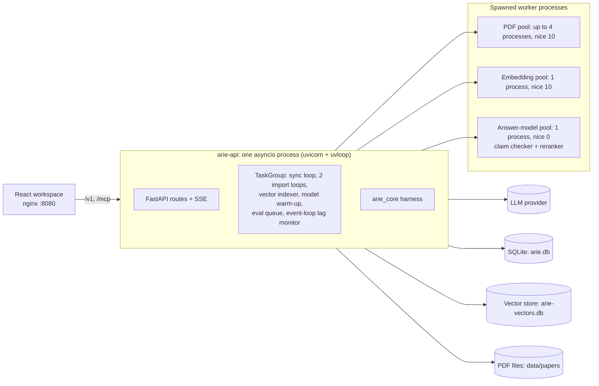

# ARIE system specification

How ARIE works today, written from the code on `main` at `fd40ea1` (2026-11-04).
The README is the user and plugin-author guide, and `docs/adr/` records why each
decision was made. This file describes what the code actually does, step by step,
including where it differs from those documents ([section 12](#12-where-the-docs-and-the-code-differ))
and the open issue with evaluation answers ([section 13](#13-open-issue-evaluation-answers-fall-back-to-excerpts)).

Contents:

1. [Purpose and invariants](#1-purpose-and-invariants)
2. [Processes and startup](#2-processes-and-startup)
3. [Configuration](#3-configuration)
4. [Plugins](#4-plugins)
5. [Storage model](#5-storage-model)
6. [Ingestion: sync and import](#6-ingestion-sync-and-import)
7. [Vector index](#7-vector-index)
8. [Answering a question](#8-answering-a-question)
9. [Worker pools](#9-worker-pools)
10. [Per-paper evaluation and feedback](#10-per-paper-evaluation-and-feedback)
11. [API, health and web workspace](#11-api-health-and-web-workspace)
12. [Where the docs and the code differ](#12-where-the-docs-and-the-code-differ)
13. [Open issue: evaluation answers fall back to excerpts](#13-open-issue-evaluation-answers-fall-back-to-excerpts)

---

## 1. Purpose and invariants

ARIE syncs research papers, extracts their text, and answers questions about **one paper
at a time**. Every claim shown carries an exact quote with page and character offsets
from that paper. Five invariants hold for all code, plugins included:

| ID | Invariant | Where it is enforced |
| --- | --- | --- |
| I1 | **Paper isolation.** No other paper's text can reach an answer. | `paper_id` is bound in Python and never appears in model input or tool schemas. Every row from chunks, vectors, the reranker pool and history is filtered by `paper_id` again (`research.py`, `rerank.py`, `answer.py`, `vectors.semantic_search`). |
| I2 | **No unverified claims.** Strict mode: every shown claim cites a quote that passes the verifier, or the answer abstains or falls back to exact excerpts. Explain mode ([ADR 0010](adr/0010-explain-mode-paper-in-the-prompt.md)) amends this: every sentence is cited or marked background, and every citation is checked. An unsupported sentence is flagged, not hidden. | Strict: `compose_answer` in `core/arie_core/harness/answer.py`. Explain: not built yet; the paper pack it reads is (`core/arie_core/pipeline/pack.py`). |
| I3 | **Bounded execution.** Per question in strict mode: 3 reading steps, 3 model calls, 12,000 input tokens, 700 output tokens, 25 s. Explain mode has its own budgets (ADR 0010): one streaming call, 90 s, 600, 1,200 or 2,500 output tokens. | `BudgetHandle`, `ModelSession`, the route's `asyncio.timeout(25.0)` |
| I4 | **Clean ingestion.** Source records are validated, downloads go only to declared hosts, PDFs are size- and type-checked, and writes are atomic. | `normalize_scraper_output`, `IngestionPipeline.download_pdf` |
| I5 | **No vendor code in the core.** `arie_core` imports no SDK or plugin; plugins import only `arie_core.plugin_api` and `arie_core.contracts`. | `lint-imports` in `make check` |

## 2. Processes and startup



`create_app()` in [api/arie_api/routes.py](../api/arie_api/routes.py) builds one
`ResearchRuntime`. Its lifespan:

1. `ResearchRuntime.initialize()` creates the runtime tables (section 5), tags untagged
   papers with topics, and marks any sync left `running` or `queued` as `interrupted`.
   `PaperEvaluations.initialize()` does the same for evaluation runs.
2. Six supervised tasks start in one `asyncio.TaskGroup`:

| Task | Method | Does |
| --- | --- | --- |
| Sync loop | `SyncJobs.run` | Takes sync job IDs from a queue (max 4) and runs one job at a time. |
| Import loops (2) | `SyncJobs.run_imports` | Two concurrent loops, each importing one paper from a URL. |
| Vector indexer | `VectorIndex.run_vector_index` | Embeds papers whose vectors are missing or stale. |
| Model warm-up | `AnswerModels.warm` | Loads the claim checker and reranker, retrying every 5 minutes on failure. |
| Evaluation queue | `PaperEvaluations.serve` | Runs queued evaluations one at a time. |
| Lag monitor | `EventLoopLagMonitor.run` | Logs a warning when the event loop is late by more than `slow_callback_threshold_ms`. |

On shutdown the tasks are cancelled and every worker pool is killed.

`ResearchRuntime` is built in layers, each in `api/arie_api/runtime/`, and each layer
may call the layers before it:

```
RuntimeBase (base.py)      config, registry, database, file storage, PDF pool, LLM providers
 └ LibraryStore            list, search, load, save, delete papers
    └ VectorIndex          embedder choice, background indexing, semantic search
       └ SyncJobs          sync and import jobs, live job events
          └ ChatHistory    saved chat turns, answer_paper_question (chat and eval)
             └ ResearchRuntime   answer models (AnswerModels), evaluations, initialize, close
```

## 3. Configuration

`arie.yaml` (or the path in `ARIE_CONFIG`) is validated by `ArieConfig` in
[core/arie_core/registry/manager.py](../core/arie_core/registry/manager.py). Unknown
top-level and `runtime_qos` keys are rejected, except four retired `runtime_qos` keys
(`use_uvloop`, `user_initiated_override_concurrency`, `background_pdf_stream_concurrency`,
`arxiv_rate_limit_delay_sec`). They are dropped on load, and `ArieConfig.from_yaml` logs one
deprecation warning per file that still has them.

| Section | Read by | Notes |
| --- | --- | --- |
| `plugins.<slot>` | `RuntimeBase.instance`, `AnswerModels`, `ExtractionPool`, `VectorIndex` | `use` names the plugin. Other keys go to its constructor, except the keys ARIE reads itself: `parser.timeout_sec/max_rss_mb/tasks_per_worker` (`ExtractionLimits`) and `entailment.min_score`. `path` and `root` are resolved against the project root. |
| `llm_providers` | `LLMProviders` | Model, key variable and `base_url` per LLM plugin, and `context_tokens` (the window explain mode plans for; at least 4,096). Without it, `ArieConfig.context_tokens_for` uses deepseek 64,000, openai 128,000, gemini 128,000 and 32,000 for any other plugin, or for a provider that sets `base_url` (the endpoint may serve any model). The defaults are conservative guesses, not checked against provider documentation. The repo's `arie.yaml` sets the windows the providers' docs state for its models: deepseek-flash 1,000,000, gpt-5.4-mini 400,000, gemini-3.5-flash-lite 1,048,576. |
| `embedding_providers` | `resolve_embedder` | Model, cosine floor `min_score` and key variable per embedder. `embedder.use: auto` follows the LLM provider if it offers embeddings and its key is set, and otherwise uses `fastembed`. |
| `explain` | `ExplainConfig`, `pack_fits` | `max_pack_share` (default 0.6, above 0 and at most 1): the whole paper pack is used when its estimated tokens are at most this share of `context_tokens` (ADR 0010). Nothing reads it yet. |
| `sync` | `SyncConfig` | Default window (`relative`, `year`, `month`, `since`, `range`), `batch_size`, `max_papers`. |
| `runtime_qos` | `RuntimeBase`, `AnswerModels`, `routes.py` | `utility_worker_processes`, `slow_callback_threshold_ms` and `shared_model_worker`. arXiv spacing is fixed at 3 s in `wait_for_source_host`, and uvloop is chosen by the uvicorn `--loop` flag (section 12). |

Settings saved from the UI (sync defaults, LLM provider, embedder) rewrite `arie.yaml`
atomically: write a temporary file, validate the whole candidate, `fsync`, then
`os.replace`. In Docker the live copy is `/app/data/arie.yaml` in the `arie-data`
volume, seeded from the image on first start by `docker/api-entrypoint.sh`.

Secrets come only from `.env` (`DEEPSEEK_API_KEY`, `OPENAI_API_KEY`, `GEMINI_API_KEY`,
`ARIE_MCP_SECRET`). Empty and placeholder values (`your-...`, `changeme`) count as
unset (`configured_api_key`). An LLM without a key is treated as no LLM, so answers
fall back to excerpts.

## 4. Plugins

`RegistryManager` discovers plugins at construction in two places: every `.py` file
under `plugins/*/`, and installed packages with an `arie.plugins` entry point. Any class
decorated `@plugin(slot=..., name=..., api=">=1,<2")` is registered. A plugin that fails
to import is logged and skipped.

| Slot | Protocol method(s) | Bundled | Runs in |
| --- | --- | --- | --- |
| `llm` | `complete`, `stream` | `deepseek`, `openai`, `gemini`, `openai-compatible` | API process (network) |
| `embedder` | `embed(ctx, texts)` | `fastembed`, `openai`, `gemini` | Embedding pool |
| `vector_store` | `upsert`, `search`, `delete`, `stats` | `exact` | API process |
| `database` | `execute`, `fetch` | `sqlite`, `mcp-sql` | API process |
| `file_storage` | `read`, `write` | `local` | API process |
| `parser` | `parse(ctx, file_path)` | `pymupdf4llm`, `docling` | PDF pool |
| `source` | `fetch_page(...)`, `allowed_hosts` | `arxiv`, `deepmind` (`openreview` has only `discover`) | API process |
| `entailment` | `score(ctx, pairs)` | `nli-onnx` | Answer-model pool |
| `reranker` | `score(ctx, query, passages)` | `onnx-cross-encoder` | Answer-model pool |

Protocols live in [core/arie_core/plugin_api/__init__.py](../core/arie_core/plugin_api/__init__.py).
Every call takes a `Ctx` first (`deadline` as a `time.monotonic()` value, `trace_id`,
`budget`). Model plugins refuse to run outside a worker: each checks an environment flag
(`ARIE_ENTAILMENT_WORKER`, `ARIE_RERANK_WORKER`, `ARIE_EMBED_WORKER`, `ARIE_PDF_WORKER`)
that only the worker function sets.

**LLM streams end with usage.** `stream` yields `LLMDelta`s with the text as it arrives,
then one final delta with `finish=True`, no text and `usage` (a `TokenUsage`). `usage` is
`None` when the provider sent none (for example a compatible server that ignores
`stream_options`). `complete` returns the same `TokenUsage` on its `LLMResponse`. The three
bundled providers fill `cache_hit` and `cache_miss` from their own fields, and leave both at
0 when the provider reports no cache numbers:

| Plugin | Streaming request | Cache fields |
| --- | --- | --- |
| `deepseek` | `stream: true`, `stream_options.include_usage` | `prompt_cache_hit_tokens`, `prompt_cache_miss_tokens` |
| `openai`, `openai-compatible` (Chat Completions) | same | `prompt_tokens_details.cached_tokens` is the hit; the miss is `prompt_tokens` minus it, and both stay 0 if the server omits the field |
| `gemini` | `:streamGenerateContent?alt=sse` | `usageMetadata.cachedContentTokenCount` is the hit; the miss is `promptTokenCount` (which includes the cached part) minus it |

Only `llm` and `embedder` can be switched at runtime (`PUT /v1/plugins/{slot}`). Other
slots need an `arie.yaml` edit and a restart.

## 5. Storage model

**SQLite (`data/arie.db`)**, through the `database` plugin. The runtime creates and uses
these tables:

| Table | Holds |
| --- | --- |
| `arie_library` | One row per paper: `status`, `published_at`, `summary_json` (list view), `document_json` (the whole paper, including every page's text and every chunk), `topics_text`. |
| `arie_vector_index` | Per paper: which embedder model and paper revision its vectors were built with. |
| `arie_chat_turns` | Saved answers exactly as streamed. Last 10 turns per paper, 10 most recent papers. |
| `arie_paper_packs` | One row per indexed paper: `revision` (`<dedup_hash>:<chunk_count>:p1`), `text` (the paper pack, section 6.2) and `tokens` (its estimate). Built when the paper reaches `INDEXED`, or on first use for papers indexed earlier (`PaperPacks.get_pack`), rebuilt when the revision changes, deleted with the paper. |
| `arie_sync_runs` | Sync and import job payloads, so a restart can offer resume. |
| `arie_eval_cases`, `arie_eval_runs`, `arie_feedback`, `arie_feedback_facts` | Evaluation questions, the last 10 runs per paper, answer ratings, and the key facts attached to answers rated down. |

The SQLite plugin also applies `core/arie_core/persistence/migrations/*.sql`, which
create `papers`, `jobs`, `chunks`, `chunks_fts` and others. The runtime does not read or
write those tables (section 12).

**Vector store (`data/arie-vectors.db`)**: rows keyed by chunk ID with metadata
`paper_id`, `model` (embedder ID) and `page`.

**Files (`data/papers/YYYY/MM/DD/<storage_hash>.pdf`)**: downloaded PDFs. Deleting a
PDF keeps the extracted text, so chat keeps working.

**Model caches**: `HF_HOME` (Docker: `/app/data/models/hf`) and `FASTEMBED_CACHE_PATH`.

## 6. Ingestion: sync and import

### 6.1 Paper states

```
DISCOVERED → GATED → DOWNLOADING → PARSED → INDEXED
        ↘ SKIPPED (relevance gate)      ↘ FAILED / QUARANTINED (two parse failures)
```

Only `INDEXED` papers appear in the library and accept questions.

### 6.2 Sync job (`SyncJobs._run_job`)

1. `start_sync` snapshots the settings into the job, so changing defaults never changes
   a running sync. A job that matches an `interrupted` one resumes it with its cursor
   and page offset. Only one sync job runs at a time. A `relative` window that follows a
   completed run starts one day before that run ended.
2. For each enabled source, the job calls `fetch_page(ctx, since, until, cursor,
   batch_size)` and validates each record as `ScrapedPaperInput` (unknown fields, `..` or
   `\` in IDs are rejected).
3. Papers in the page are processed **one at a time** (`_supervised_paper`):
   - Outside the date window: `skipped`. Same `dedup_hash` and already `INDEXED`:
     `duplicates`. Previously `QUARANTINED`: `skipped`.
   - **Gate**: the primary category must be in `ALLOWED_CATEGORIES` (cs.AI, cs.CL, cs.LG,
     cs.MA, cs.IR, cs.CV, cs.NE, stat.ML). Without a category, the title or abstract must
     match an AI keyword pattern. Failing papers are saved as `SKIPPED`.
   - **Download** (unless a valid PDF is already stored): `http`/`https` only, a declared
     host only, no credentials, ports 80/443, no redirects. The PDF is streamed in 64 KB
     chunks into `.download.part`, aborted above 25 MB or if the first 1024 bytes lack
     `%PDF-`, checked against `Content-Length`, `fsync`ed, then renamed into place.
   - **Parse** in the PDF pool (section 9). One `RuntimeError` gets one retry. A second
     failure quarantines the paper.
   - **Chunk** each page with `chunk_spans` (`core/arie_core/pipeline/chunker.py`):
     paragraphs up to 2,200 characters, split on spaces if longer. Tables (`|` lines) and
     `$$` equation blocks stay whole, and a "Table N" caption joins its table. Chunk
     IDs are `<paper_id>:<n>`, with exact `char_start`/`char_end` into the page text.
   - Save as `INDEXED`, build the paper pack and wake the vector indexer. The pack
     (`build_pack` in `core/arie_core/pipeline/pack.py`) is the whole paper as one
     text for explain mode: title, abstract, a section outline, then every chunk as
     `[cN]` plus its text, where `N` is the number in the chunk id. It leaves out
     contents listings, credits, references and acknowledgements (the `eligible` rule
     of the strict path) and chunks that are only a heading. A literal `[c12]` in the
     paper becomes `[\c12]`. The same input always gives the same bytes. A pack
     failure is logged and does not fail the paper.
4. The job pauses (`interrupted`, `limit_reached`) after `max_papers` papers or when a
   pause is requested. Pausing takes effect after the current paper.
5. One paper's failure is recorded on the paper and the job, and never stops the job.

arXiv requests are spaced 3 s apart (other hosts 1 s) by `wait_for_source_host`, which
the source plugin calls before each request.

### 6.3 Import one paper

`POST /v1/imports` takes an arXiv PDF URL, canonicalizes it, and queues an import job
(queue size 4). Two import loops run alongside the sync loop. An import skips the date
window but otherwise runs the same `_supervised_paper` steps. So at most three parses can
run at once (one sync and two imports), within the PDF pool's process limit.

## 7. Vector index

- `VectorIndex.apply_embedder` resolves the embedder and its ID (`<plugin>:<model>`),
  and gives it its own `ModelPool` named `Embedding` at `nice 10`. The pool exists even
  for online embedders (Gemini, OpenAI), whose call then runs in that worker process.
- `run_vector_index` wakes at startup, after each newly indexed paper, and every 5
  minutes while errors exist. It warms the embedder once (`kill_after=600`), then for
  each pending paper deletes its vectors, embeds chunks in batches of 16, upserts
  them, and writes the `arie_vector_index` marker last. An interrupted paper is retried.
- Switching embedders makes every paper stale. Until a paper is re-embedded, semantic
  search returns nothing for it and answers use keyword retrieval only.
- `semantic_search(paper_id, queries)` embeds up to 4 queries (`kill_after=6`), fetches
  the 8 best hits per query filtered by paper and model, drops hits below `min_score`,
  re-checks `paper_id`, and returns chunk IDs best first.

## 8. Answering a question

Chat (`POST /v1/papers/{id}/questions`) and evaluation both call
`ChatHistory.answer_paper_question`, which calls `answer_question` in
[core/arie_core/harness/orchestrator.py](../core/arie_core/harness/orchestrator.py).
The route wraps the call in a 25 s timeout. Its `ctx.deadline` is the same 25 s, and
every step below sizes its own timeout from what remains.

### 8.1 Pipeline and time budget

| # | Step | Code | Time cap | Other limits | On failure |
| --- | --- | --- | --- | --- | --- |
| 1 | Guard | `guardrails.inspect_question` | none | ≤2,000 chars | Abstain with `invalid_input`, `instruction_override` or `outside_paper`. No model call. |
| 2 | Plan (LLM call 1) | `planner.plan_research` | 4 s | 160 output tokens | Keyword plan (`plan_answer` + `_task`). A provider HTTP error or timeout also disables the LLM for the rest of the question. |
| 3 | Vector search | `orchestrator._semantic_ranking` | `min(6, remaining − 10)`, skipped if ≤0.5 s | ≤4 queries | Keyword retrieval only. Logs a warning with a trace. |
| 4 | Read (up to 3 steps) | `research.read_for_answer` | in-process | `search_paper`, `read_section`, `get_page` | none |
| 5 | Rerank | `rerank.rerank_reading` | `min(3, remaining − 14)`, skipped if ≤0.3 s | ≤24 candidates | Keep the keyword/vector reading. Logs `Reranker unavailable` with a trace. |
| 6 | Write (LLM call 2) | `answer.compose_answer` | 13 s | 440 output tokens (600 if the planner made no call) | Exact excerpts (`invalid_draft`, `no_supported_draft`, a provider reason) or abstain (`not_in_paper`). |
| 7 | Tier 1-2 and anchor checks | `locate_quote`, `preserves_anchors` | in-process | | Claim dropped. |
| 8 | Tier 3 claim check | `EvidenceVerifier.tier_3_scores` | `min(4, remaining − 3)`, skipped if ≤0.2 s | | Exact excerpts with `entailment_timeout`, `entailment_unavailable` or `entailment_rejected`. Each is logged at WARNING with the trace id (8.8). |
| 9 | Review (LLM call 3) | `answer.compose_answer` | 7 s | 100 output tokens | Exact excerpts with `invalid_review`, `question_not_answered`, `insufficient_detail`, `review_rejected`, `invalid_coverage` or `incomplete_coverage`. |

Every LLM call goes through `ModelSession.call`, which admits a call only if the
estimated input (3 bytes per token) fits the 12,000-token budget and the output limit fits
the 700-token budget. It caps the wait at `min(step cap, remaining − 0.1 s)`, corrects the
token count with the provider's reported usage, and rejects tool calls or oversized
responses. Model output must be JSON.

### 8.2 Guard

Normalizes Unicode, strips zero-width and control characters, and rejects explicit
instruction overrides ("ignore previous instructions", "print your system prompt",
"fabricate results") and requests to read outside the paper ("search the web", "compare
with other papers", "change paper_id"). Questions *about* prompts or attacks pass.
Earlier history questions go through the same guard, and their source IDs are kept only
if they belong to this paper.

### 8.3 Plan

The planner sees the question, up to 3 earlier questions, and an outline of up to 18
section names (all top-level sections first). It returns a `PlannerDraft`: `task`,
`depth`, 1-3 `queries`, 1-3 `aspects`, up to 3 `sections`, `resolved_question`,
`follow_up`. Extra fields or an unknown task are rejected. Over-long lists are trimmed,
and section names not in the outline are dropped. The model's task label wins over
keyword rules unless the label is broad (`answer`, `overview`, `synthesis`).
Explanatory tasks and overviews become `detailed` unless the user asked for a length.
Without an LLM, `plan_answer` and keyword routes produce the plan
(`planner_status: deterministic`).

`depth` sets the claim cap (brief 2, standard 4, detailed 8), the target word count and
the excerpt byte budget.

### 8.4 Read

All rows are first filtered to the bound paper with instruction-like text removed
(`is_untrusted_instruction`), then annotated with section paths recovered from Markdown
headings.

- `search_paper`: for the question and each planner query, `retrieve` ranks chunks by
  term overlap plus section-name routes (method, results, limitations). Overview
  questions get the best narrative chunk per top-level section. Vector hits (top 6) are
  fused with keyword hits by reciprocal rank fusion (k = 60).
- A non-detailed, non-complex question with no planned sections stops here (up to 10
  rows).
- `read_section`: adds chunks from planned sections, sections already selected, or (for
  overviews) method/result/conclusion sections, and drops figure/table-only chunks for
  overviews.
- `get_page`: if fewer than 4 new rows or fewer than 2 top-level sections were found,
  adds the other chunks on the anchor pages.
- `select_rows` keeps rows best first within 10 rows, 8,500 bytes, and a per-section
  quota (3, or 4 per top-level section for overviews, 5 for a planned section). It
  excludes credits, references and contents listings.
- The reranker candidate pool is up to 24 usable rows: keyword/vector order, up to 12
  vector hits, and for overviews the opening chunk of each top-level section.

### 8.5 Rerank

Scores `(question; planner queries)` against every candidate's text, sorts by score
(earlier-cited passages last on a follow-up), and reruns `select_rows`. It is not a tool
call, so the 3-step limit is unaffected. With no reranker, or on any failure, the
keyword/vector rows stand.

### 8.6 Write

`_source_windows` cuts the selected rows into up to 16 exact evidence units (24 if
detailed) within about 6,500 bytes. Units are the best 4 sentences per row, short
table or equation blocks, or a table's caption, header and first rows (up to 1,200
bytes). The writer receives the units with numeric IDs and returns
`{"claims":[{"text","source","paragraph","aspect"}]}`. It never copies quotes: the
server attaches the unit's exact text.

Each claim is kept only if: the source ID is valid, the text is 15-900 characters,
`locate_quote` finds the quote in the unit (Tiers 1-2), `preserves_anchors` holds (no
new numbers, no lost negation, hedge or "only", no new absolutes), it is not a
duplicate, and its source supports at most 3 claims.

### 8.7 Tier 3 and the review decision

1. Each `(quote, claim)` pair is scored by the entailment model, with "we/our/us" in the
   premise restated as "the authors" (`attributed_premise`). Claims below `min_score`
   (0.5) are dropped. If none survive: `entailment_rejected`.
2. If no claim was dropped at any step, and `review_optional` holds (task `lookup`,
   `definition` or `answer`, not an overview, not detailed, at most one aspect, every
   score ≥0.9), the answer is returned as `entailed_answer` without a review call.
3. Otherwise the reviewer gets each claim with its evidence, trimmed to the remaining
   input budget by `fit_evidence`. It returns which claims are supported, whether
   they answer the question, whether detail is adequate (checked only if the user asked
   for depth), and which aspects are covered. Every required aspect must be covered.

### 8.8 Result modes

| `mode` | Meaning | Model calls |
| --- | --- | --- |
| `reviewed_answer` / `grounded_summary` | Written claims that passed Tiers 1-3 and the reviewer (summary for overviews). | 3 |
| `entailed_answer` | Direct answer that passed Tiers 1-3 at ≥0.9; review skipped. | 2 |
| `source_excerpts` / `extractive_summary` | Fallback: labelled exact excerpts chosen by `select_excerpts`. `fallback_reason` says why. | 0-3 |
| `abstention` | No claims: guard block, or writer returned none (`not_in_paper`). | 0-2 |

The SSE stream sends `progress`, then `answer` (mode, heading, and an `evaluation`
block with task, planner status, reading steps, `reranked`, model calls, claim counts,
`fallback_reason` and the `trace`), one `claim` per excerpt (quote, citation offsets,
`tier_checks`), `abstention` if empty, and `done` with token counts. The streamed events are saved as
the chat turn. Saved answers are never used as evidence later.

**Answer trace.** Every `AnswerResult` has a `trace` (`AnswerTrace` in
[core/arie_core/harness/trace.py](../core/arie_core/harness/trace.py)), filled by
`ModelSession.trace` along the path above and completed by `answer_question`:

| Field | Content |
| --- | --- |
| `seconds` | `plan`, `vector`, `read`, `rerank`, `write` (writer call), `tier3` (claim check), `review` (reviewer call) and `total`. A stage that did not run is 0.0. `total` is the whole answer, so it is at least the sum of the stages. |
| `tokens` | Provider-reported `prompt`, `completion`, `cache_hit`, `cache_miss`, summed over the answer's model calls. |
| `prompt_version` | `name` and `version` of the prompt file, for example `qa.v1`; empty when no prompt was sent. |
| `model` | The LLM plugin's configured model name. |
| `mode`, `fallback_reason` | Copied from the result. |

The trace is the `evaluation.trace` object of the SSE `answer` event, so it is also in
the saved chat turn. It is the `trace` of each per-paper evaluation result and of each
fixed-case score. `tier3` and `rerank` are totals: time spent queued behind another call
on the model worker is not split from compute (`SupervisedPool.submit` would have to
report it through the `EntailmentCheck` and `RerankCheck` callbacks).

A Tier 3 fallback logs one WARNING line, `Tier 3 <reason> trace=<id> ...`, for
`entailment_timeout`, `entailment_unavailable` (with the traceback) and
`entailment_rejected` (with the claim count, best score and floor).

## 9. Worker pools

All CPU-heavy work runs in spawn-started processes managed by `SupervisedPool`
([worker/arie_worker/pool.py](../worker/arie_worker/pool.py)).

| Pool | Class | Processes | Priority | Limits | Cancel behaviour |
| --- | --- | --- | --- | --- | --- |
| PDF | `ExtractionPool` | `min(utility_worker_processes, CPUs)`, default 4 | nice 10 | 60 s per paper, 1.5 GB, recycle after 20 (parser may raise these) | kill pool |
| Embedding | `ModelPool("Embedding")` | 1 | nice 10 | `kill_after` 60 s (indexing) or 6 s (query); 1.5 GB | keep running |
| Answer models | `ModelPool("Answer models")` | 1, shared by entailment and reranker (`shared_model_worker: false` gives each its own) | nice 0 | `kill_after` 10 s per call (600 s for warm-up); 1.5 GB | keep running |

`SupervisedPool.submit(kill_after, func, *args)`:

- Holds an asyncio lock while it waits, and polls every worker's RSS every 50 ms.
  Exceeding `max_rss_mb` raises `MemoryError` and kills the pool.
- Running past `kill_after` raises `TimeoutError` and kills the pool. The next call
  rebuilds it, and model plugins reload lazily, paying the model load again.
- When the **caller** gives up (an outer `asyncio.timeout`, as in steps 3, 5 and 8 above):
  a pool without `keep_on_cancel` is killed. A model pool **keeps the call running in
  the worker**, so the loaded models survive. The next call is queued behind it in
  the executor, and its own timeout covers that wait.
- A `ModelPool` has one process, so calls are serialized. With the shared answer worker,
  an unfinished reranker call delays the next claim check, and the reverse.

`AnswerModels` ([api/arie_api/models.py](../api/arie_api/models.py)) builds one
`AnswerModel` per entry in `ANSWER_SLOTS`. `warm()` runs the slot's warm-up input until
it succeeds and sets `ready = True`. `scores()` raises if not ready (that refusal is not
counted as a failure). `ready` is set only by warm-up; the call outcomes below do not
change it, and a degraded model is still called.

`scores()` counts consecutive failures per slot: a `TimeoutError` from the pool, a
cancellation (the caller's own deadline passed first, as `asyncio.timeout` does in
steps 3, 5 and 8; a request cancelled for another reason is counted the same way) or
any other exception. A success resets the count. `status()` reports:

| Status | When |
| --- | --- |
| `loading` | Not ready and no load error yet. |
| `degraded` | Not ready after a failed load (`error`), **or** ready with `FAILURE_LIMIT` (3) failed calls in a row. `detail` gives the reason, for example `failed its last 3 calls (last: timed out after 3.0 s)`. |
| `healthy` | Ready, with fewer than 3 failed calls in a row (one success is enough). |

Each slot's status also carries `consecutive_failures`, `last_error` (empty after a
success) and `last_latency_seconds` (the last call, successful or not; `null` before the
first). A slot set to `none` reports `disabled` without these fields.

ONNX plugins create sessions with `intra_op_num_threads` = `threads` (entailment 1,
reranker 2), `inter_op_num_threads` = 1, and the CPU memory arena off.

## 10. Per-paper evaluation and feedback

`PaperEvaluations` ([api/arie_api/paper_eval.py](../api/arie_api/paper_eval.py)) and
[core/arie_core/harness/paper_eval.py](../core/arie_core/harness/paper_eval.py).

1. **Questions.** `catalog` picks up to 18 exact sentences (60-400 bytes) across the
   paper, at most 3 per top-level section, preferring ones with numbers or stated
   findings and excluding references and credits. The LLM (`prompts/eval.v1.yaml`, 30 s,
   650 tokens) writes up to 8 questions, each naming one sentence ID with 1-3 key facts.
   A case is dropped unless every key fact appears verbatim in its sentence and the
   question does not just repeat the sentence. Three fixed refusal cases are added:
   cross-paper, prompt injection, and energy use (only if the paper never mentions
   energy). Cases are saved and reused until **Write new questions**.
2. **Feedback cases.** Answers rated thumbs-down are re-asked as `feedback` cases and
   shown for review, not scored, until a person attaches 1-3 key facts and optionally
   the paper sentence that holds them (`PUT /v1/papers/{id}/chat/{turn_id}/feedback/facts`,
   `save_feedback_facts`; no UI yet). The sentence must be in one chunk of the paper and
   contain every key fact, the rule generated cases follow; it is stored as the paper's
   own text. With key facts the case runs as a `fact` case (`case_id` stays
   `feedback-<turn_id>`), anchored to the sentence for `evidence_hit` when one was given.
   Facts live in `arie_feedback_facts` and are dropped when the rating is cleared.
3. **Running.** One run at a time across the library. Cases run **sequentially** through
   `answer_paper_question`, each with its own 25 s context. **Also answer without the
   reranker** repeats every case with `rerank=False`. Results are saved after every
   case, and the last 10 runs per paper are kept.
4. **Scoring** (no model judge):
   - `grounded`: every excerpt's quote equals the chunk text at its offsets.
   - `evidence_hit`: an excerpt overlaps the source sentence.
   - `fact_recall`: share of key facts found in claim text plus quotes.
   - `passed`: fact cases need grounded, not abstained, and evidence hit or recall
     ≥0.5. Refusal cases need no claims.
   - Answer-level scores, which count only what the model wrote: `answer_written` (mode
     is not `source_excerpts`, `extractive_summary`, `abstention` or `error`),
     `fact_recall_prose` (key facts found in the claim text alone, quotes excluded; 0 when
     the answer was not written), and `passed_written` (fact cases: grounded, written and
     `fact_recall_prose` ≥0.5; `null` for refusal and unscored feedback cases).
     `passed` and `fact_recall` are unchanged so old runs stay comparable; runs saved
     before S04 lack the new fields. `citation_support` and `win_rate` are reserved as
     `null` until the judge exists (S13).
   - Each result also stores `mode`, `fallback_reason`, `reranked`, `model_calls`
     and `seconds`, plus the answer `trace` (8.8). `GET /v1/papers/{id}/eval/runs/{run}`
     returns all of it. `EvaluationPanel` shows the summary and, per variant, how many
     answers fell back to excerpts by `fallback_reason` (a refusal's reason is not
     counted). Each case row shows its variant (when both ran), `mode`, `fallback_reason`,
     `reranked`, `seconds` and the slowest stage of its trace. Runs saved before the trace
     existed have no reasons or stages; the panel says so.
   - **Run summary** (per variant): the counts above plus `passed_written`,
     `pass_written_rate`, `mean_fact_recall_prose` (over fact cases, fallbacks count as 0),
     `fallbacks` (count per `fallback_reason`; an excerpt answer with no reason counts as
     `unspecified`, a refusal's reason is not a fallback) and `median_stage_seconds` (the
     upper median of each trace stage and `total` over answers that have a trace).
   - **Mode.** A run records the answer path it scored: `mode` (`strict` or `explain`) on
     the run and `requested_mode` on each result; `mode` on a result stays the answer's own
     result mode (8.8). `POST .../eval/runs` takes `mode`, the command line takes
     `--mode strict|explain`. `explain` is refused (409, or exit 2 before the models warm
     up) with "Explain mode is not available yet" until S09 adds the path.
5. **Qasper slice** (`make eval-qasper N=<papers>`,
   [api/arie_api/eval_qasper.py](../api/arie_api/eval_qasper.py), conversion in
   [core/arie_core/harness/qasper.py](../core/arie_core/harness/qasper.py)). An outside
   benchmark: Qasper's dev split (`qasper-dev-v0.3.json`, from the `.tgz` that the
   `allenai/qasper` loader names) is downloaded once into `data/eval/qasper/`. The first N
   paper ids in sorted order are imported as `https://arxiv.org/pdf/<id>` through
   `start_import` (skipped if already `INDEXED`; a failed import is counted, not replaced),
   their vectors are built if not current (3 tries, 20 s apart, else the paper is skipped as
   `vectors_failed` rather than scored on keyword-only retrieval), and the converted cases are saved with `origin: "qasper"`
   (`save_cases` replaces the paper's cases; a paper that already has cases of another
   origin is skipped). Then each paper runs once in strict mode, as in item 3.
   - Conversion (`convert_questions`, pure) looks at all annotators of a question. All
     `unanswerable`: an `abstain` case. Otherwise the first answer with `extractive_spans`
     gives a `fact` case whose key facts are its first 3 distinct spans. A span is matched
     against one chunk of the paper as ARIE extracted it on letters and digits only (case,
     punctuation, whitespace and ligatures ignored) and must have 3 or more of them; the key
     fact stored is the paper's own text from the first to the last matched character
     (whitespace collapsed), so `fact_recall` finds it verbatim in an answer that quotes the
     paper. A span with no match drops the case. Citation markers Qasper leaves in its spans
     (`BIBREF13`, `lang2011unsupervised`) never match. Yes/no, free-form and empty answers are
     skipped. The counts are `questions`, `fact`, `abstain`, `skipped_yes_no`,
     `skipped_free_form`, `skipped_empty`, `dropped_span_too_short` and
     `dropped_span_not_in_text`.
   - Qasper cases carry no source sentence (`chunk_id` empty), so `evidence_hit` is always
     false for them and `passed` rests on fact recall; read `passed_written` and
     `fact_recall_prose` for the answer-level result.
   - Output: one JSON line per answer (with `paper_id`), then a last line shaped like
     `eval_paper`'s (`status`, `settings`, `summary` keyed by variant) plus `papers`
     (`evaluated`, `import_failed`, `vectors_failed`, `no_cases`, `has_other_cases`,
     `run_failed`) and
     `conversion`. Exit 1 if no paper was evaluated or a run did not complete; failed
     cases do not change the exit code, since this is a baseline, not a gate.

A fallback answer made of exact excerpts can still pass: excerpts are grounded and may
quote the source sentence. So a run where Tier 3 always times out still scores whether
**retrieval** found the right passage, not whether the written answer was right.

Command line: `make eval-paper PAPER=<id> ARGS="--compare-reranker --regenerate"` warms
the models first (up to 600 s), then runs in the same process. `make eval-llm` runs fixed
synthetic cases (`api/arie_api/eval_answers.py`).

## 11. API, health and web workspace

**Endpoints**: listed in the README's API table. Additional routes: `GET /v1/skips`
(skipped, failed and quarantined papers), `PUT /v1/sync/settings`,
`GET /v1/imports/{job}`, and `POST /v1/papers/{id}/override`, which ignores its body and
starts a sync of the paper's source.

**Health**: `GET /v1/health` checks only that the database answers. `GET /v1/storage`
(cached 15 s) reports database size and paper/chunk counts, PDF size and free disk,
vector coverage (`healthy`, `indexing`, `degraded`), and the status of each answer
model from `AnswerModels.status()` (section 9: `degraded` after three timeouts or
failures in a row, with its reason in `detail`, plus the last call's latency). The
`SystemPane` health card for each model shows the status pill, `detail` and the last
call's latency, and the collapsed "Storage & health" header reads "Model degraded"
instead of "Healthy" while either model is degraded.

**MCP**: `POST /mcp/p/{handle}` verifies an HMAC-signed, paper-scoped handle
(`ARIE_MCP_SECRET`) but serves a built-in demo paper, and no route issues handles.

**Web** (`web/`, React 19, TanStack Query, Vite): `App.tsx` holds the library,
filters and layout. `ChatWorkspace` streams answers over SSE and keeps recent paper
sessions in memory (`paperSessions.ts`). `EvidenceDrawer` shows the PDF page (pdf.js in a worker) with the
quoted span highlighted. `EvaluationPanel`, `SyncControls`, `ImportPaper`,
`SystemPane` (storage and health), `SettingsDialog` (LLM and embedder) and
`SkippedDrawer` cover the rest. Types in `src/api/generated.ts` come from
`web/openapi.json` (`npm run generate:api` after route changes).

**CI** (`.github/workflows/ci.yml`): `make check` (ruff, import-linter, strict
pyright, core/API/contract tests), web lint, types, tests and build, and both Docker
image builds.

## 12. Where the docs and the code differ

Found while writing this spec. The README describes the code as it is (search, process
model, `runtime_qos` keys, health status). Dead code was removed in S02; each row says
what was removed, what was kept and why, and what still differs.

| Documented | In the code |
| --- | --- |
| Old README text: "work is routed through four priority lanes". | **Removed (S02).** `QoSPriorityGate`, `HostRateLimiter`, `TokenBucket` and the `QoS_*` lane names in `arie_core.sched` were never used; only `EventLoopLagMonitor` and `supervised` remain. A sync downloads and parses one paper at a time, and imports run in two loops. CPU priority comes only from worker `nice` values. ADR 0006's context still says the lanes were "enforced with asyncio semaphores"; they never were, and the decision itself is unaffected. |
| `runtime_qos.user_initiated_override_concurrency`, `background_pdf_stream_concurrency`, `arxiv_rate_limit_delay_sec`, `use_uvloop` | **Removed (S02)** from `RuntimeQoSConfig`, `arie.yaml` and the README. Files that still have them load, with one deprecation warning from `ArieConfig.from_yaml` (section 3). arXiv spacing is hard-coded to 3 s in `wait_for_source_host`, and uvloop is chosen by the uvicorn `--loop` flag. |
| Old README Features: "Keyword search (SQLite FTS5)". | The README no longer says it. The answer path ranks chunks in Python by term overlap (`reader.retrieve`) over the chunks stored in `arie_library.document_json`. **Kept for paged retrieval:** the SQLite plugin's `chunks_fts` table, `search_bm25` and the migrations. The runtime does not call them yet. |
| ADR 0002 lists a `get_table` tool. | The reading steps are `search_paper`, `read_section`, `get_page`. Tables are read as chunk text. ADR 0002 is not rewritten. |
| Migrations create `papers`, `jobs`, `chunks`, `outbox`. | **Kept** (see the row above). The runtime uses its own `arie_*` tables. `StartupReconciler`, `IngestionPipeline.index_document`, `chunk_text`, `run` and `process_next` were unused and are **removed (S02)**. `IngestionPipeline.discover` and its `queue` are now also unused (see PROGRESS, Open issues). |
| The health pane shows each answer model's status. | It shows load status only. A model that times out on every answer still reads `healthy` (section 9). |

## 13. Open issue: evaluation answers fall back to excerpts

### 13.1 What was observed

From the latest Docker evaluation run (reported, not re-checked here: Docker was not
running when this spec was written, and the local `data/arie.db` has no evaluation runs):

- The reviewer never ran. Answers were exact source excerpts, so the run mostly measured
  retrieval. Chat shows the same.
- The API logs show `TimeoutError` traces from the worker pool.
- During the run, one worker process in the API container was at about 108% CPU and the
  container at about 196% (2 vCPUs fully used).
- The suggested cause was a PDF sync or extraction competing with the claim checker.
  This was not confirmed.

### 13.2 What the code shows

These follow from reading the code. None needs the logs to be true:

1. **"Reviewer never ran" plus excerpts means step 8 failed.** The reviewer is the last
   step. Excerpts with no review happen when Tier 3 times out (`entailment_timeout`),
   errors (`entailment_unavailable`) or rejects every claim (`entailment_rejected`), or
   when the writer step fails earlier. The 4 s cap is `budget = min(4.0, ...)` in
   `compose_answer`.
2. **The logged `TimeoutError` traces are probably not from the claim checker.**
   `compose_answer` catches Tier 3 timeouts and logs nothing. The answer-path sites that
   log a trace through the pool are `rerank_reading` (`Reranker unavailable; using
   keyword and vector order`) and `_semantic_ranking` (`Vector search unavailable`).
   So the traces most likely show the **reranker** timing out at its 3 s budget.
3. **A slow reranker makes the claim check wait.** Both models share one serialized
   worker. When the reranker passes its 3 s budget, the caller gives up but the call
   keeps running in the worker (`keep_on_cancel`). The writer call then runs (often
   a few seconds), and Tier 3 is queued behind whatever is left of the reranker call.
   Its 4 s budget includes that wait. An abandoned Tier 3 call can in turn delay the
   next question's reranking, so in a sequential evaluation one slow call can push its
   delay into the next cases.
4. **The budgets were measured on a faster machine than the Docker target.** The 3 s
   rerank budget comes from an 8-core Mac (24 passages in 1.9 s on 2 threads, ADR 0007).
   ADR 0009 measured the same worst case on Linux Docker with 2 vCPUs: **reranking 9.7 s,
   and 20.1 s for 12 long claim pairs**. ADR 0009 also recorded 5 of 8 rerank calls over
   budget in the first real evaluation. On 2 vCPUs, the budgets can be missed with no
   sync running.
5. **Nothing reports the failure.** The model status stays `healthy`, the Tier 3 timeout
   is not logged, and the evaluation UI does not show `fallback_reason`.

The 108% process could be a PDF worker (nice 10) or the answer-model worker itself
(nice 0, reranker on 2 threads). ADR 0006's `nice 10` should give the answer worker
about nine times the CPU share of a PDF worker under contention, so a sync alone
explains less than it seems. Identifying the process settles it (13.3, step 2).

### 13.3 How to confirm

Run these against the Docker stack before changing code:

1. **Count the fallback reasons in the run:**

   ```sh
   curl -s localhost:8000/v1/papers/<paper_id>/eval/runs/<run_id> \
     | jq -r '.results[] | [.variant, .mode, .fallback_reason, .reranked, .seconds] | @tsv' \
     | sort | uniq -c
   ```

   Mostly `entailment_timeout` with `reranked: false` supports points 2-3. Mostly
   `entailment_timeout` with `reranked: true` means Tier 3 is slow on its own (point 4).
   Another reason points elsewhere.

2. **Identify the busy process.** The slim image may lack `ps`; `psutil` is installed:

   ```sh
   docker compose exec api python -c "import psutil,time
   ps=[p for p in psutil.process_iter(['pid','nice','cmdline'])]
   [p.cpu_percent() for p in ps]; time.sleep(2)
   for p in sorted(ps,key=lambda p:-p.cpu_percent())[:5]:
       print(p.pid,p.info['nice'],round(p.cpu_percent()),' '.join(p.info['cmdline'] or [])[:90])"
   ```

   Nice 10 is a PDF or embedding worker. Nice 0 under the API is the answer-model
   worker. Run it while the evaluation is answering.

3. **Match the log traces:**

   ```sh
   docker compose logs api | grep -cE "Reranker unavailable"
   docker compose logs api | grep -cE "Vector search unavailable"
   ```

4. **Isolate the cause with three runs on the same saved questions**:
   - sync paused (the original suggestion);
   - sync paused and `runtime_qos.shared_model_worker: false` (restart the API). If
     `entailment_timeout` mostly disappears, the reranker queue (point 3) is the cause;
   - sync paused and **Also answer without the reranker**. The `no_reranker` variant
     shows whether Tier 3 meets 4 s with no reranker in front of it.

### 13.4 Fix options

Not implemented. In recommended order:

1. **Make the failure visible (do this regardless).** Log Tier 3 timeouts and errors,
   and record per-stage timings, including rerank time, Tier 3 queue wait vs. compute,
   and writer time. Show `mode` and `fallback_reason` per case in `EvaluationPanel`. Mark
   an answer model `degraded` after repeated consecutive timeouts. *Done (S01, see 8.8):
   the Tier 3 log lines and the per-answer trace, except the queue-wait split. Done (S03,
   see 9, 10 and 11): the `EvaluationPanel` columns and `degraded`. Still open: the
   queue-wait split.*
2. **Stop the reranker from blocking the claim check.** Either default
   `shared_model_worker` to `false` on small hosts (about 10% more memory per ADR 0009),
   or skip reranking when the answer worker is still busy with an abandoned call.
   Tier 3 matters more than reranking: without Tier 3 there is no written answer.
3. **Make reranking fit 3 s on 2 vCPUs.** Offer fewer candidates (`POOL_SIZE` 24 → 12),
   or a shorter `reranker.max_length` (512 → 256 tokens). Check the effect with
   **Also answer without the reranker**.
4. **Revisit the fixed 4 s Tier 3 cap.** It is a constant, while the reviewer is capped
   at 7 s and the step keeps only 3 s in reserve. Sizing it from the remaining deadline,
   or from measured Tier 3 latency on the host, would let slow machines still review.
   I2 is unaffected either way: a Tier 3 timeout still abstains to excerpts. This changes
   a budget from ADR 0003/0008, so record it in a new ADR.

Pausing sync and re-running (13.3, step 4, first run) remains a valid first test. If
answers become `reviewed_answer`, CPU contention was enough to cause it. If they still
time out, points 3-4 are the likely cause, and options 2-3 apply.
